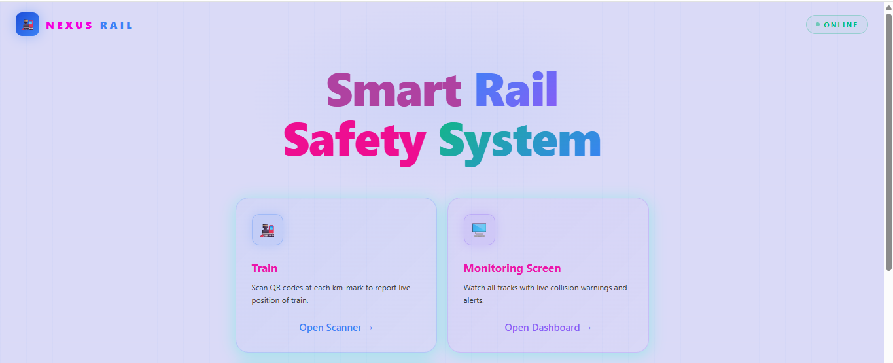
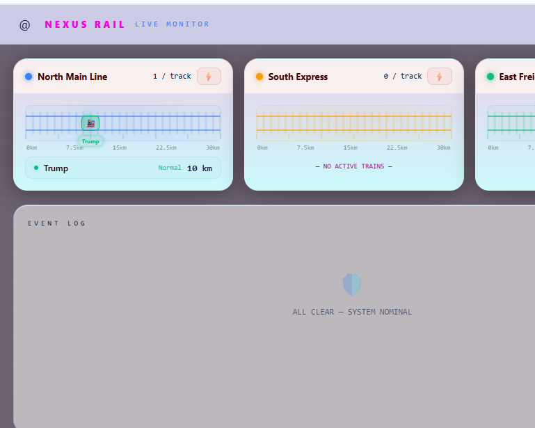
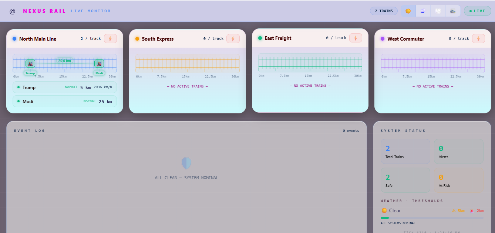
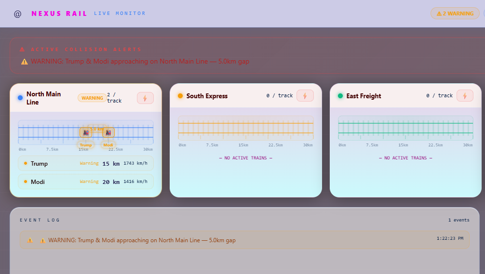
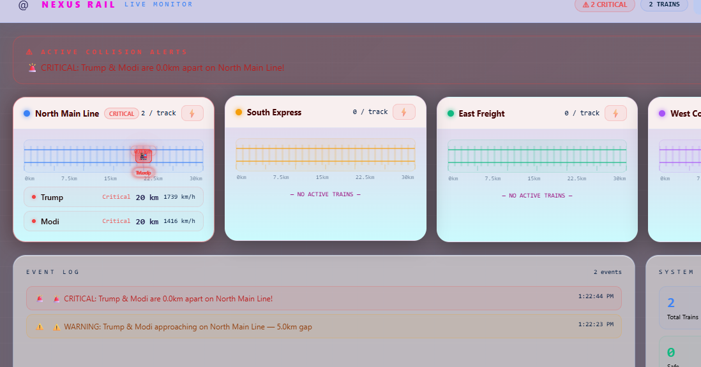

# Railway Collision Detection System (QR Scanner Based)

A real-time web application that helps prevent train collisions. QR codes placed at fixed points along the track act as position markers. Each train scans the markers with a camera, reports its position live to a central server, and the system raises an alert when two trains get dangerously close on the same track.

> Items in `[square brackets]` are placeholders. Fill them in with your actual values.


## Overview

Collisions on railways are often caused by signalling failures, low visibility, or human error. GPS can be unreliable in tunnels and cuttings. This project uses QR-coded track markers as a low-cost, easy-to-maintain way to know where each train is, and detects collision risk from those positions in real time.

## How It Works

1. **Track markers:** Unique QR codes are placed at fixed positions along each track. Each code identifies a track and a position on it.
2. **Scanning:** The client app on the train uses the device camera (`CameraScanner`) to read each QR marker as the train passes.
3. **Live updates:** The scanned position is sent to the server over WebSockets, so every connected client sees up-to-date train positions (`useLiveState`).
4. **Collision check:** The server stores each train's state and compares trains on the same track. If two trains are within the safe distance, it creates an `Alert`.
5. **Alert broadcast:** The alert is pushed to all connected clients immediately and saved in the database for history.

```
QR markers -> Camera scanner (client) -> Socket -> Server -> Collision logic -> Alert
                                                      |                         |
                                                   MongoDB  <------------------+
                                                      |
                                           Live updates to all clients
```

## Features

- QR-based train position tracking using the device camera
- Real-time position sync across clients via WebSockets
- Collision risk detection for trains on the same track
- Instant alerts, stored in the database for review
- Configurable tracks and markers (`tracks.js`)
- REST API for train and alert data

## Tech Stack

**Client**
- React + Vite
- `[QR scanning library, e.g. html5-qrcode / jsQR]`
- `[socket.io-client]`

**Server**
- Node.js `[+ Express]`
- `[Socket.IO]` for real-time communication
- MongoDB `[+ Mongoose]` for storing trains and alerts

## Project Structure

```
Train/
├── client/
│   ├── src/
│   │   ├── components/
│   │   │   ├── CameraScanner.jsx   # QR scanner using the camera
│   │   │   └── CameraScanner.css
│   │   ├── config/
│   │   │   └── tracks.js           # Track and marker definitions
│   │   ├── hooks/
│   │   │   └── useLiveState.js     # Live train/alert state from the server
│   │   ├── pages/
│   │   ├── App.jsx
│   │   ├── main.jsx
│   │   └── index.css
│   ├── index.html
│   ├── vite.config.js
│   └── package.json
├── server/
│   ├── config/
│   │   ├── db.js                   # Database connection
│   │   └── tracks.js               # Track definitions used for collision logic
│   ├── models/
│   │   ├── Train.js                # Train schema
│   │   └── Alert.js                # Alert schema
│   ├── routes/
│   │   └── api.js                  # REST API routes
│   ├── socket/
│   │   └── handlers.js             # WebSocket event handlers
│   ├── index.js                    # Server entry point
│   └── package.json
└── README.md
```

## Getting Started

### Prerequisites

- Node.js `[version]` or later
- MongoDB (local or Atlas)
- A device with a camera for scanning (a phone works well)

### Installation

```bash
# Clone the repository
git https://github.com/Prince-kumar-27/TrainCollision.git


# Install server dependencies
cd server
npm install

# Install client dependencies
cd ../client
npm install
```

### Run the app

```bash
# Terminal 1 - start the server
cd server
npm start        # or: node index.js

# Terminal 2 - start the client
cd client
npm run dev
```

Open the client URL shown by Vite (usually `http://localhost:5173`) and allow camera access when prompted.

> Camera access in browsers requires HTTPS or `localhost`. To test on a phone, serve the client over HTTPS (e.g. with a tunnelling tool).

## Environment Variables

Create a `.env` file inside `server/`:

```env
PORT=[5000]
MONGO_URI=[your-mongodb-connection-string]
```

Do not commit `.env` to Git (it is already covered by `.gitignore`).

## Usage

1. Generate QR codes for each marker defined in `tracks.js` and place them along your (demo) track.
2. Start the server and open the client on one device per train.
3. Select the train and scan the markers as it moves.
4. Watch live positions update on every client.
5. Move two trains close together on the same track to see the collision alert.


## Future Scope

- Combine with GPS/RFID for redundancy
- Automatic braking integration
- Predicting collision risk from speed and direction
- Control-room dashboard and SMS/push notifications
- Weather- and speed-robust marker designs

## Author

**Prince Kumar**
B.Tech CSE (AI & ML), JIS College of Engineering, Kalyani

##------------------------------------------------##
#screenshots







